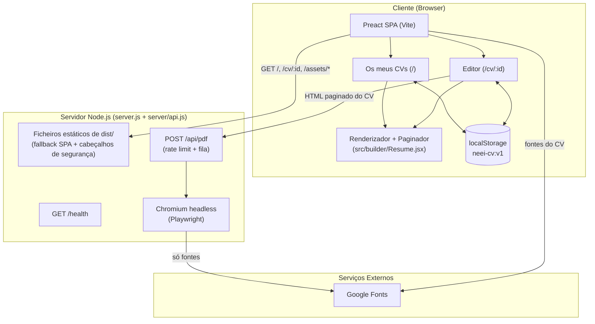
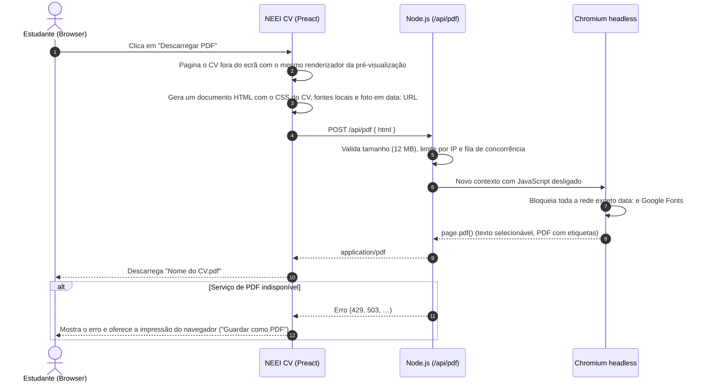

# 📄 NEEI CV

[](https://nodejs.org/)
[](https://preactjs.com/)
[](https://vitejs.dev/)
[](https://vitest.dev/)
[](https://playwright.dev/)
[](https://coolify.io/)

> **Construtor de currículos do Núcleo de Estudantes de Engenharia Informática da Universidade do Algarve.**

O **NEEI CV** é a ferramenta gratuita do **Núcleo de Estudantes de Engenharia Informática (NEEI)** da
**Universidade do Algarve (UAlg)**, associado à **AAUAlg**, para criar currículos profissionais em minutos:
escolhes um modelo, preenches o teu percurso com pré-visualização paginada em tempo real e descarregas
um PDF com texto selecionável, pronto a enviar para estágios e empregos.

---

## 📑 Tabela de Conteúdos

- [✨ Funcionalidades Principais](#-funcionalidades-principais)
- [🎨 Modelos](#-modelos)
- [📐 Arquitetura](#-arquitetura)
  - [Diagrama de Arquitetura do Sistema](#diagrama-de-arquitetura-do-sistema)
  - [Diagrama de Sequência: Exportação para PDF](#diagrama-de-sequência-exportação-para-pdf)
  - [Rotas](#rotas)
- [🛠️ Tecnologias](#️-tecnologias)
- [🚀 Instalação & Execução Local](#-instalação--execução-local)
- [⚙️ Variáveis de Ambiente](#️-variáveis-de-ambiente)
- [🐳 Deploy no Coolify](#-deploy-no-coolify)
- [🔒 Segurança](#-segurança)
- [📂 Estrutura do Projeto](#-estrutura-do-projeto)
- [⚠️ Limitações Conhecidas](#️-limitações-conhecidas)
- [📞 Contactos & Redes Oficiais](#-contactos--redes-oficiais)

---

## ✨ Funcionalidades Principais

### 1. Os meus CVs (`/`) 🗂️

- **Página de boas-vindas** para quem entra pela primeira vez, com os passos e uma pré-visualização dos modelos.
- **Galeria de modelos:** cada modelo mostra uma miniatura real com texto de exemplo; um clique cria o CV.
  Também é possível começar com um **CV em branco** ou **importar JSON**.
- **Lista de CVs** com miniatura da primeira página, número de páginas e data da última edição.
- **Pesquisar e ordenar** (recentes, mais novos, nome), mudar o nome, duplicar, descarregar PDF, exportar JSON e apagar.

### 2. Editor (`/cv/:id`) ✍️

- **Dados pessoais** com foto (recortada e reduzida no navegador) e detalhes extra (LinkedIn, GitHub, site, …).
- **15 tipos de secção:** Resumo, Experiência, Formação, Competências, Idiomas, Certificados, Interesses,
  Projetos, Cursos, Prémios, Organizações, Publicações, Referências, Declaração e Personalizada.
- **Arrastar para reordenar** secções e entradas (ou usar o menu "Mover para cima/baixo"), esconder e mudar títulos.
- **Texto rico** (negrito, itálico, sublinhado, listas, ligações) e datas mês/ano que funcionam em todos os navegadores.
- **Pré-visualização paginada em tempo real:** textos longos continuam na página seguinte (parágrafo a parágrafo,
  tópico a tópico) em vez de serem cortados. O PDF sai igual à pré-visualização, página a página.
- **Anular/refazer** (Ctrl+Z / Ctrl+Y), gravação automática e zoom da pré-visualização.

### 3. Personalização 🎨

- **7 modelos** prontos, e podes trocar de modelo a qualquer momento sem perder o que escreveste.
- **Tipografia:** 21 Google Fonts + CMU Serif (a Computer Modern do LaTeX, incluída no projeto).
- **Layout:** uma ou duas colunas, posição e largura da barra lateral, cabeçalho, foto, estilo dos títulos,
  datas, níveis de competência, rodapé com número de página, margens e espaçamentos.
- **Cor de destaque** aplicável elemento a elemento (nome, títulos, datas, ícones, …).
- **Página A4 ou US Letter** e **idioma do CV** (PT, EN, ES, FR, DE) para títulos de secção e datas.

### 4. Experiência de utilização 💡

- Interface em **português**, **tema claro/escuro** (com preferência do sistema e sem *flash* ao carregar)
  e **layout para telemóvel**.
- **Acessível:** navegação por teclado, `aria-*`, diálogos e menus semânticos, respeita `prefers-reduced-motion`.
- **Sem conta:** abre e começa. Para continuar noutro computador, exporta o CV em JSON e importa-o lá.

---

## 🎨 Modelos

| Modelo | Descrição |
| :--- | :--- |
| **NEEI** | Duas colunas com o azul do NEEI |
| **Clássico** | Sóbrio e serifado, ao estilo LaTeX (inspirado no [Jake's Resume](https://github.com/jakegut/resume)) |
| **Moderno** | Uma coluna, limpo e atual |
| **Barra lateral** | Barra lateral de cor com foto |
| **Cronologia** | Datas à esquerda, em cronologia |
| **Faixa** | Cabeçalho numa faixa de cor |
| **Compacto** | Denso: cabe mais numa página |

Os modelos são apenas predefinições de design (`TEMPLATES` em `src/builder/data.js`): o conteúdo do CV
é independente do modelo, e qualquer definição pode depois ser ajustada no separador **Personalizar**.

---

## 📐 Arquitetura

### Diagrama de Arquitetura do Sistema



Não há base de dados: o servidor é *stateless* e serve apenas a aplicação e a geração de PDFs.

### Diagrama de Sequência: Exportação para PDF



### Rotas

O projeto usa um router próprio e mínimo (`src/lib/router.jsx`, ~40 linhas, sobre a History API) em vez de
*file-based routing*. As rotas estão definidas à mão em `src/main.jsx`:

| URL | Página | Ficheiro |
| :--- | :--- | :--- |
| `/` | Os meus CVs | `src/pages/Dashboard.jsx` |
| `/cv/:id` | Editor do CV | `src/pages/Editor.jsx` |
| qualquer outro | redireciona para `/` | |

No servidor, qualquer caminho sem extensão devolve o `index.html` (fallback SPA); ficheiros em falta dão 404.

---

## 🛠️ Tecnologias

| Área | Tecnologia | Propósito |
| :--- | :--- | :--- |
| **Frontend** | [Preact 11](https://preactjs.com/) | Interface reativa e leve (~3 kB) |
| **Build Tool** | [Vite 8](https://vitejs.dev/) | Servidor de desenvolvimento com HMR e build de produção |
| **Estilos** | CSS próprio | Paleta e identidade visual do neei.online, tema claro/escuro |
| **Ícones** | [Lucide](https://lucide.dev/) (`lucide-preact`) | Iconografia consistente com os outros projetos do NEEI |
| **Arrastar e largar** | [SortableJS](https://sortablejs.github.io/Sortable/) | Reordenar secções e entradas |
| **Backend** | [Node.js](https://nodejs.org/) (`node:http`) | Ficheiros estáticos, API de PDF e *health check* |
| **PDF** | [Playwright](https://playwright.dev/) (`playwright-core`) + Chromium | Impressão do CV paginado em PDF |
| **Tipografia** | [Google Fonts](https://fonts.google.com/) + [CMU Serif](https://en.wikipedia.org/wiki/Computer_Modern) | 22 fontes à escolha |
| **Testes** | [Vitest](https://vitest.dev/) + jsdom | Testes unitários do modelo de dados, paginação e HTML seguro |
| **Deploy** | [Coolify](https://coolify.io/) + [Docker](https://www.docker.com/) | Build multi-stage e publicação automática |

---

## 🚀 Instalação & Execução Local

### Pré-requisitos

- **Node.js 22.12** ou superior.
- **Microsoft Edge** ou **Google Chrome** instalado (usado para gerar os PDFs em desenvolvimento),
  ou o caminho de um Chromium em `PDF_BROWSER`.

### Passos

1. **Clonar o repositório:**

   ```bash
   git clone https://github.com/neei-aaualg/cv-builder.git
   cd cv-builder
   ```

2. **Instalar as dependências:**

   ```bash
   npm install
   # No Windows PowerShell:
   npm.cmd install
   ```

3. **Executar em modo de desenvolvimento** (inclui a API de PDF):

   ```bash
   npm run dev        # http://localhost:5173
   ```

4. **Correr os testes:**

   ```bash
   npm test
   ```

5. **Executar a build de produção localmente:**

   ```bash
   npm run preview    # build + servidor em http://localhost:3000
   ```

Não é preciso ficheiro `.env`: todas as variáveis são opcionais.

---

## ⚙️ Variáveis de Ambiente

| Variável | Obrigatória | Valor Padrão | Descrição |
| :--- | :---: | :--- | :--- |
| `PORT` | Não | `3000` | Porta em que o servidor HTTP escuta |
| `HOST` | Não | `0.0.0.0` | Interface de rede |
| `PDF_BROWSER` | Não | detetado | Caminho para o Chromium/Chrome/Edge |
| `PDF_CONCURRENCY` | Não | `2` | PDFs gerados em simultâneo (cada um usa ~100–200 MB de RAM) |
| `PDF_RATE_LIMIT` | Não | `20` | PDFs por minuto por IP |
| `CHROMIUM_NO_SANDBOX` | Não | `1` na imagem Docker | Desliga a *sandbox* do Chromium (necessário em contentores) |

---

## 🐳 Deploy no Coolify

O `Dockerfile` segue o mesmo modelo do [site do NEEI](https://github.com/neei-aaualg/siteneei) e do
[NEEI-Box](https://github.com/neei-aaualg/NEEI-Box): build multi-stage em `node:22-alpine`, utilizador sem
privilégios e `HEALTHCHECK` contra `/health`. A imagem final inclui o Chromium para gerar os PDFs.

1. Criar um registo DNS para o subdomínio (por exemplo `cv.neei.online`) a apontar para o servidor do Coolify.
2. No Coolify, criar uma aplicação a partir deste repositório com *Build Pack* **Dockerfile**.
3. Porta exposta: **3000**. Domínio: `https://cv.neei.online`.
4. **Não é preciso volume persistente** nem variáveis de ambiente obrigatórias: o servidor não guarda dados.

> O contentor precisa de acesso à Internet para `fonts.googleapis.com` e `fonts.gstatic.com`, para que os PDFs
> usem as fontes escolhidas. Sem acesso, o PDF é gerado com fontes de recurso.

Recomendado no proxy (Traefik/Coolify): **compressão gzip/brotli** e **HSTS**, que o servidor Node não aplica.

---

## 🔒 Segurança

- **Renderização isolada:** o HTML recebido em `/api/pdf` é aberto num contexto novo do Chromium com
  **JavaScript desligado** e **sem acesso à rede**, exceto imagens `data:` e Google Fonts (sem `file://`,
  rede interna ou *trackers*).
- **Limites:** tamanho máximo do pedido (12 MB), pedidos por IP por minuto, concorrência e fila limitadas,
  e *timeout* de 30 s por PDF.
- **Texto rico limpo:** o HTML do editor é sanitizado (`src/builder/html.js`) antes de ser mostrado ou impresso;
  só são aceites ligações `http(s)`, `mailto` e `tel`.
- **Cabeçalhos de segurança:** *Content-Security-Policy* restritiva, `X-Content-Type-Options`, `Referrer-Policy`,
  `Permissions-Policy` e `frame-ancestors 'none'`.
- **Dados validados:** CVs importados (JSON) ou lidos do `localStorage` são validados e normalizados (`normalizeResume`).
- **Sem dados pessoais no servidor:** nada é guardado nem registado além de erros internos.

---

## 📂 Estrutura do Projeto

```text
cv-builder/
├── index.html                 # Documento base HTML
├── server.js                  # Servidor de produção: ficheiros de dist/, API, cabeçalhos de segurança
├── server/
│   └── api.js                 # POST /api/pdf (Chromium headless) e GET /health; também usado pelo Vite em dev
├── src/
│   ├── main.jsx               # Arranque, providers e rotas (/ → Dashboard, /cv/:id → Editor)
│   ├── pages/                 # Uma página por ficheiro
│   │   ├── Dashboard.jsx      # Os meus CVs
│   │   └── Editor.jsx         # Editor do CV
│   ├── components/            # Componentes partilhados: cabeçalho/rodapé NEEI, modal, diálogos, menus, select, miniaturas
│   │   ├── dashboard/         # Partes de Os meus CVs: hero, lista de CVs, galeria de modelos, diálogo "Novo CV"
│   │   └── editor/            # Partes do Editor: barra superior, pré-visualização, anular/refazer
│   ├── builder/               # Motor do CV: modelo de dados e modelos, renderizador/paginador, CSS do CV, HTML seguro
│   │   ├── content/           # Separador Conteúdo: dados pessoais, secções, entradas, texto rico, datas
│   │   └── customize/         # Separador Personalizar: definições de design, modelos, controlos
│   ├── lib/                   # Store (localStorage), router, tema, fontes, exportação PDF
│   └── styles/app.css         # Estilos da aplicação (paleta do neei.online)
├── public/
│   ├── fonts/                 # CMU Serif (Computer Modern), licença SIL OFL em CMU-Serif-OFL.txt
│   └── theme-init.js          # Aplica o tema antes do primeiro render (sem flash)
├── tests/                     # Testes unitários (Vitest)
├── Dockerfile                 # Build multi-stage + Chromium
├── vite.config.js             # Configuração do Vite, da API em dev e dos testes
└── package.json               # Metadados e dependências do projeto
```

---


## 📞 Contactos & Redes Oficiais

- 📧 **Email Oficial:** [neei@aaualg.pt](mailto:neei@aaualg.pt)
- 💬 **Discord:** [discord.gg/HzBuRFCAb5](https://discord.gg/HzBuRFCAb5)
- 📷 **Instagram:** [@neeiualg](https://instagram.com/neeiualg)
- 📘 **Facebook:** [NEEIUALG](https://www.facebook.com/NEEIUALG/)
- 💼 **LinkedIn:** [NEEI UAlg](https://www.linkedin.com/company/neeiualg)
- 🐙 **GitHub:** [github.com/neei-aaualg](https://github.com/neei-aaualg)

---

Desenvolvido e mantido com ❤️ pela equipa do **Núcleo de Estudantes de Engenharia Informática da AAUAlg**.
